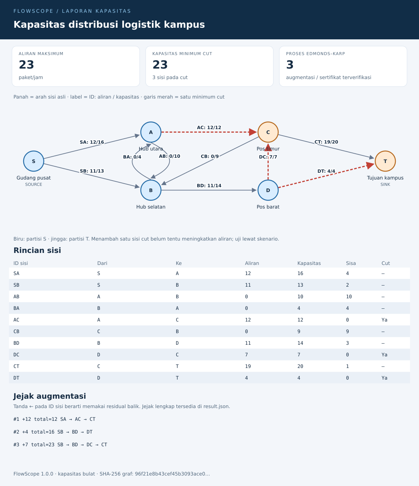

# FlowScope

FlowScope adalah CLI TypeScript untuk menganalisis **aliran maksimum dan minimum cut** pada jaringan berarah. Masukkan kapasitas jalur distribusi, jaringan komunikasi, atau model penugasan; periksa alokasi aliran, jejak perhitungannya, lalu bandingkan perubahan kapasitas sebelum mengambil keputusan.

Proyek harian 3 November 2026 · Node.js 22 atau lebih baru · tanpa dependensi runtime · lisensi MIT.



## Lima fitur yang saling terhubung

1. Validasi graf JSON, termasuk ID unik, kapasitas bulat, simpul asal/tujuan, sisi paralel, dan sisi antiparalel.
2. Solver Edmonds–Karp dengan residual balik yang benar, alokasi setiap sisi, satu minimum cut, dan jejak augmentasi lengkap.
3. Verifier terpisah yang memeriksa kapasitas, konservasi, nilai cut, SHA-256 graf, dan replay semua langkah residual tanpa menjalankan solver.
4. Laporan SVG statis beserta JSON yang dapat disimpan, dibuka kembali, dan diperiksa secara offline.
5. Skenario perubahan kapasitas: hitung ulang aliran dan minimum cut, lalu lihat selisih terhadap jaringan awal.

## Jalankan langsung

Unduh ZIP proyek atau clone repositori, lalu buka terminal pada direktori proyek. JavaScript hasil kompilasi sudah disertakan dalam `dist/`; **tidak perlu `npm install` untuk menjalankan CLI**.

```sh
node --version
node bin/flowscope.mjs solve examples/logistik.json --out hasil
node bin/flowscope.mjs verify examples/logistik.json hasil/result.json
```

Buka `hasil/report.svg` menggunakan browser atau penampil SVG. Semua perintah di atas dapat dijalankan melalui PowerShell, Command Prompt, atau terminal Linux/macOS. Direktori `hasil` harus belum ada; pilih nama lain saat mengulang.

Ringkasan contoh:

```json
{
  "title": "Kapasitas distribusi logistik kampus",
  "unit": "paket/jam",
  "value": 23,
  "cutCapacity": 23,
  "cutEdges": ["AC", "DC", "DT"],
  "augmentations": 3,
  "certificateValid": true
}
```

Dengan `--out`, ringkasan juga menyertakan path output. Tanpa `--out`, CLI hanya mencetak ringkasan dan tidak membuat berkas.

### Bandingkan skenario

```sh
node bin/flowscope.mjs solve examples/logistik.json --scenario examples/tambah-kapasitas.json --out hasil-skenario
node bin/flowscope.mjs verify hasil-skenario/scenario-graph.json hasil-skenario/scenario-result.json
```

Contoh menaikkan kapasitas `DT` dari 4 menjadi 10. Aliran maksimum berubah **23 → 26 paket/jam**, sehingga manfaat aktualnya +3. Menambah kapasitas salah satu sisi cut belum tentu menaikkan aliran sebesar penambahannya: sisi lain dapat menjadi hambatan baru. CLI benar-benar menghitung ulang jaringan skenario.

| Berkas hasil | Isi |
| --- | --- |
| `graph.json` | Graf dasar yang sudah dinormalisasi |
| `result.json` | Aliran, minimum cut, digest graf, dan jejak dasar |
| `report.svg` | Visualisasi dan tabel jaringan dasar |
| `scenario-graph.json` | Graf setelah perubahan kapasitas, jika ada skenario |
| `scenario-result.json` | Sertifikat dan jejak skenario |
| `scenario-report.svg` | Visualisasi jaringan skenario |
| `comparison.json` | Nilai sebelum/sesudah dan selisih dalam satuan yang sama |

Output disimpan sebagai berkas biasa. Tidak ada server, telemetri, atau koneksi jaringan saat menjalankan aplikasi. Direktori lama ditolak; kegagalan penulisan akan membersihkan direktori baru yang dibuat aplikasi. Penghentian paksa oleh sistem bisa meninggalkan direktori parsial; hapus atau gunakan nama baru setelah memeriksa isinya.

### Instalasi CLI opsional

Untuk menyediakan perintah `flowscope` pada PATH:

```sh
npm install --global . --ignore-scripts
flowscope --help
```

Paket lokal membawa JavaScript hasil kompilasi dan contoh input, tanpa dependensi runtime. Ini tidak menerbitkan paket ke npm. Untuk mengubah source, gunakan langkah pengembangan di bawah.

## Format masukan

Graf kecil berikut menghasilkan aliran maksimum 7:

```json
{
  "version": 1,
  "title": "Satu jalur distribusi",
  "unit": "paket/jam",
  "source": "S",
  "sink": "T",
  "nodes": [
    {"id": "S", "label": "Gudang"},
    {"id": "A", "label": "Hub"},
    {"id": "T", "label": "Tujuan"}
  ],
  "edges": [
    {"id": "SA", "from": "S", "to": "A", "capacity": 10},
    {"id": "AT", "from": "A", "to": "T", "capacity": 7}
  ]
}
```

Aturan:

- `version`, `source`, `sink`, `nodes`, dan `edges` wajib. `title`, `unit`, serta `label` opsional dengan nilai bawaan.
- 2–32 simpul, maksimal 160 sisi. Kapasitas bulat 0–1.000.000.000; pecahan dan kapasitas negatif ditolak. Batas ini menjaga semua penjumlahan tetap dalam rentang integer aman JavaScript.
- ID diawali huruf ASCII, dilanjutkan huruf/angka/`_`/`-`, maksimal 32 karakter. ID sisi dan simpul masing-masing harus unik.
- `source` dan `sink` harus berbeda. Sisi harus merujuk simpul yang ada. Self-loop ditolak; sisi paralel dan dua arah didukung dengan ID berbeda.
- Label maksimal 60 karakter UTF-16, judul 100, satuan 20. Karakter kontrol dan Unicode surrogate tidak berpasangan ditolak. Teks di-escape sebelum masuk SVG.
- File UTF-8 berukuran maksimal 512 KiB. Properti asing ditolak agar salah ketik tidak diam-diam diabaikan. File sertifikat untuk `verify` maksimal 16 MiB.

Skenario hanya mengubah kapasitas sisi yang sudah ada; simpul dan topologi tetap:

```json
{"version": 1, "capacities": {"SA": 20, "AT": 12}}
```

Gunakan ID yang ada pada graf terkait dan sertakan minimal satu entri. Nilai kapasitas boleh turun maupun naik.

## Cara membaca laporan

- Label sisi menunjukkan `ID: aliran/kapasitas`; panah mengikuti arah sisi asli.
- Biru dan jingga menandai partisi S dan T dari **satu** minimum cut. Minimum cut lain dengan kapasitas sama mungkin ada.
- Garis merah menandai sisi asli dari partisi S ke T. Sisi jenuh lain tidak otomatis merupakan anggota cut.
- Pada jejak, `←ID` berarti aliran sisi tersebut dikurangi melalui residual balik. Sisi residual balik bukan kapasitas asli tambahan.
- SVG menampilkan maksimal 12 augmentasi pertama. `result.json` menyimpan seluruh jejak. Label graf panjang disingkat secara visual; teks lengkap tersedia di tooltip, tabel, dan graf JSON.
- Tata letak otomatis memakai lapisan BFS. Untuk graf padat, beberapa garis dapat bersilangan; tabel sisi dan JSON tetap menyediakan data lengkap.

`verify` membuktikan bahwa aliran layak dan nilainya sama dengan kapasitas cut. Kesamaan ini menjadi sertifikat optimalitas. Verifier juga memastikan replay jejak menghasilkan aliran akhir yang sama. SHA-256 mengikat hasil pada graf normalisasi, termasuk urutan simpul/sisi dan metadata; sertifikat bukan tanda tangan digital atau bukti identitas pembuat.

Exit code: `0` berhasil, `1` sertifikat tidak valid, `2` kesalahan input atau IO. Pesan kesalahan dikirim ke stderr. Gunakan `--help` untuk sintaks lengkap.

## Struktur dan keputusan teknis

| Modul | Tanggung jawab |
| --- | --- |
| `src/model.ts` | Model, validasi JSON, normalisasi, digest, perubahan kapasitas |
| `src/solver.ts` | Edmonds–Karp dan pasangan sisi residual per sisi asli |
| `src/verify.ts` | Verifikasi sertifikat dan replay independen |
| `src/svg.ts` | Layout lapisan BFS, kurva sisi paralel, tabel dan visual SVG |
| `src/io.ts` | Pembacaan UTF-8 berbatas ukuran dan output eksklusif |
| `src/cli.ts` | Alur solve/compare/verify, argumen dan exit code |
| `dist/` | JavaScript dan deklarasi tipe hasil build TypeScript |
| `test/` | Pengujian algoritma, validasi, sertifikat dan CLI end-to-end |
| `tools/verify-package.mjs` | Pack dan pemasangan lokal offline ke direktori temporer |

Pendalaman teknis proyek ini adalah **algoritma graf beserta sertifikat optimalitas dan visualisasi**. Edmonds–Karp memilih jalur residual terpendek menggunakan BFS, dengan kompleksitas O(V × E²). Pasangan residual tidak digabung berdasarkan pasangan simpul, sehingga sisi antiparalel tidak merusak pembatalan aliran. Semua hasil deterministik untuk urutan input yang sama; tanggal sistem tidak dimasukkan ke perhitungan.

Persistensi memakai graf dan laporan JSON karena alur aplikasi merupakan analisis berkas offline. Tidak diperlukan database. SVG menggunakan markup statis tanpa script atau resource eksternal. JavaScript hasil build disertakan agar CLI juga berjalan dari `node_modules`, tanpa bergantung pada kemampuan Node mengeksekusi source TypeScript.

API programatik setelah build:

```js
import { parseGraph, solve, verify } from './dist/index.js';
const graph = parseGraph(inputJson);
const result = solve(graph);
console.log(result.value, verify(graph, result).valid);
```

Selalu gunakan `parseGraph` untuk masukan luar sebelum memanggil solver, renderer, atau verifier.

## Pengembangan dan pengujian

```sh
npm ci --ignore-scripts
npm run typecheck
npm test
npm run verify:package
```

Gunakan source dari ZIP proyek atau repositori untuk pengembangan; tarball npm hanya membawa aplikasi siap jalan, contoh, dan dokumentasi. Dependensi pengembangan dikunci dalam `package-lock.json`. `npm test` membangun ulang `dist/` sebelum menjalankan Node test runner. Setelah mengubah source, jalankan build/test sebelum membagikan paket siap jalan.

Pengujian meliputi jaringan contoh, residual balik, sisi paralel/antiparalel, graf terputus, kapasitas nol/maksimum, manipulasi sertifikat dan trace, input rusak, perlindungan output lama, serta integrasi solve → skenario → laporan → verify. Sebanyak 400 graf kecil acak dibandingkan dengan oracle independen yang mengenumerasi semua partisi cut. Pemeriksaan paket memasang tarball lokal secara offline dan menjalankan CLI yang sudah berada dalam `node_modules`.

Hasil aktual dan lingkungan pemeriksaan dicatat dalam [VERIFICATION.md](VERIFICATION.md). Proyek ini memodelkan satu source, satu sink, dan satu jenis komoditas dengan kapasitas tetap; biaya, lower bound, routing nyata, dan beberapa komoditas berada di luar cakupannya.

Referensi algoritma: [penjelasan dan implementasi Edmonds–Karp](https://cp-algorithms.com/graph/edmonds_karp.html).
